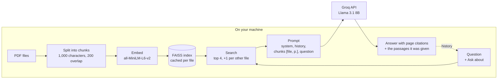
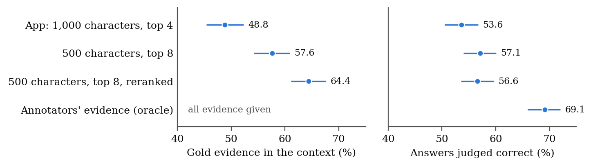

# Document - Question and Answer App

[](https://github.com/David-Alobo/document_question_and_answer/actions/workflows/ci.yml)

A Streamlit app for asking questions about research papers. Upload one or more PDFs, ask in a
chat, and get answers that cite the pages they came from, with the passages the model was given
listed under each answer. The app has been evaluated on 1,005 questions about 281 research
papers (see [Evaluation](#evaluation)). It is intended for research purposes only.

## Features

- **Several PDFs at once** (up to 10). Each file is embedded once and cached.
- **Answers with page citations**, and the retrieved passages shown under each answer.
- **"Ask about"**: search all files, or restrict a question to one of them.
- **"Compare these documents"**: one click asks for a comparison; retrieval takes at least one
  passage from each file.
- **Conversation memory**, with a slider for how many past exchanges are sent.
- **Local embeddings**: only the retrieved passages and the conversation are sent to Groq.

## How it works



Each PDF is read page by page, split into overlapping chunks and embedded locally. For each
question the closest chunks are retrieved, labelled with file and page, and sent with the system
prompt and recent conversation to a model on Groq. `LocalVectorStore` can also rerank the
retrieved chunks with a cross-encoder (`reranker=Utils.load_reranker()`); this is used in the
evaluation and is not yet switched on in the app.

## Installation

Requires Python 3.10+ and [uv](https://docs.astral.sh/uv/).

```bash
git clone https://github.com/David-Alobo/document_question_and_answer.git
cd document_question_and_answer
uv sync
```

Add your Groq API key to a `.env` file in the root directory, or paste it into the sidebar
when the app starts:

```
GROQ_API_KEY=your_groq_api_key
```

Without uv: `pip install -r requirements.txt`.

## Usage

```bash
uv run streamlit run main.py
```

Open the address Streamlit prints, upload one or more PDFs, and ask questions. Choose the model
and the number of past exchanges to remember in the sidebar.

## Evaluation

The app's own retrieval and prompting code was run on the development set of
[QASPER](https://allenai.org/data/qasper) (1,005 questions about 281 NLP papers, using the
papers' arXiv PDFs), with Llama 3.1 8B answering and Qwen3-32B judging the answers.

| Version | Answers judged correct |
|---|---|
| As first released (a bug sent the first question without the question or the document) | 0.0% |
| Fixed | 53.6% [50.5, 56.7] |
| 500-character chunks, top 8 | 57.1% [54.0, 60.1] |
| 500-character chunks, top 8, reranked | 56.6% [53.5, 59.6] |
| The annotators' own evidence given to the model (upper bound for retrieval) | 69.1% [65.9, 72.0] |



95% intervals. The four retrieved chunks held the gold evidence for 48.8% of questions, and
given the evidence directly the model answers 15 points more questions correctly. Smaller
chunks and reranking put evidence in the context more often (left), but neither changed
correctness detectably after correcting for two comparisons (right), so the app keeps its
settings for now.

Two more findings:

- **Loading other papers hides the right one.** With nine other papers loaded, the evidence
  for a question about one of them reached the context for 31.9% of questions instead of 48.8%.
  Choosing the paper under "Ask about" restores the single-paper rate.
- **Retrieval tests alone would have misled us.** Across 36 retrieval set-ups at the same prompt
  length, 500-character chunks with reranking were among those that retrieved evidence most
  often (65.5% against 49.4% for the app's settings), but on answers they did no better.

Every run, with per-question outputs and a README, is in [`eval/results/`](eval/results/); the
scripts are in [`eval/qasper/`](eval/qasper/). A paper describing the evaluation is being
written in [`paper/`](paper/); its numbers, tables and figures are generated from the saved
results (`paper/make_numbers.py`, `paper/make_figures.py`).

## Project layout

| Path | Contents |
|---|---|
| `main.py` | Streamlit entry point |
| `src/` | PDF processing, vector store, prompts and Groq client |
| `test/` | Unit tests (`uv run pytest`) |
| `eval/` | QASPER evaluation scripts and saved results |
| `paper/` | Manuscript and supplementary information (LaTeX) |
| [`ROADMAP.md`](ROADMAP.md) | Planned changes: section-aware chunking, per-paper comparisons, a held-out test |

## Limitations

- Intended for research purposes only. Answers can be wrong; check them against the cited
  pages.
- Text only: figures and tables in the PDFs are not read as such.
- Scanned PDFs without a text layer cannot be read.

## Contributing

Contributions are welcome. Please fork the repository and open a pull request; CI runs ruff and
the tests on Ubuntu and Windows.

## Acknowledgments

Streamlit, LangChain, Groq, FAISS, Sentence Transformers, uv, and the authors of QASPER.

## Licence

MIT, see [LICENSE](LICENSE).
